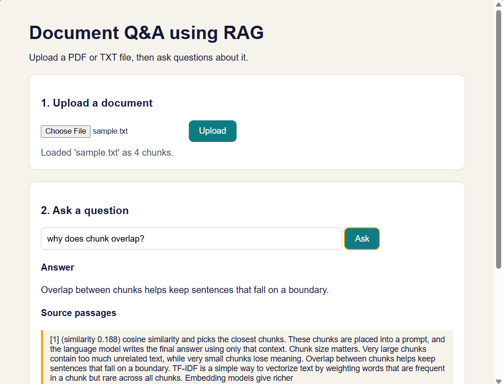

# Document Q&A using RAG
A web app that answers questions from an uploaded PDF or text file using Retrieval Augmented Generation (RAG). Each answer is shown with the source passages it came from.

Built during my Generative AI with LLMs internship at SkillDzire (Apr–Jun 2026).

## How it works
1. **Load**: reads the uploaded PDF/TXT (pypdf).
2. **Chunk**: splits text into 80-word chunks with 20 words of overlap.
3. **Vectorise**: TF-IDF vectors, written in plain Python (no ML libraries).
4. **Retrieve**: cosine similarity picks the top 3 chunks. If nothing matches, the app says so instead of guessing.
5. **Generate**: the chunks and the question go to the Gemini API with an instruction to answer only from the context.
6. **Show**: the answer and the source passages with their scores.


## Tech stack
Python, Flask, pypdf, Gemini API, HTML/JavaScript

## Run it
```bash
pip install -r requirements.txt
set GEMINI_API_KEY=your-key        # Windows PowerShell: $env:GEMINI_API_KEY="your-key"
python app.py
```
Open http://127.0.0.1:5000, upload `sample.txt` and ask: "Why does chunk overlap help?"

Optional: choose another model with the `GEMINI_MODEL` environment variable.

## Features
- Answers grounded in the document, with visible sources
- Retry on busy API errors (429/500/503) and a fallback model
- Retrieval implemented from scratch (TF-IDF + cosine similarity)

## Limitations
- TF-IDF matches words, not meaning; embeddings would improve this
- One document at a time; the index is kept in memory

## Files
- `app.py`: Flask routes (`/`, `/upload`, `/ask`)
- `rag.py`: the RAG pipeline
- `templates/index.html`: the web page
